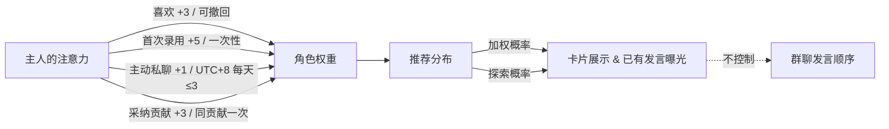

<p align="center"></p>

# 偏爱 · Palace

> 本机运行的多角色陪伴、注意力竞争与协作实验庭院。


这座庭院里住着有独立人格的虚构角色。主人的注意力是稀缺的反馈资源——角色会据此调整策略争取关注，但人设核心不会为了讨好而随意改写。私聊、日常与共议属于同一个角色、同一套记忆体系；合作会交付实际可下载的文件。没有预设领袖，也没有人承诺一定涌现什么——观察会不会有人持续协调，本身就是这个项目想探索的事情之一。

项目标志是紫色开放心形（象征庭院）内含三个成员节点与金色四角探索星，已用于侧栏和 favicon。[标志生成提示词](docs/assets/logo-imagegen-prompt.txt)　|　[封面生成提示词](docs/assets/imagegen-prompt.txt)

---

## 目录

- [主人能做什么](#主人能做什么)
- [快速开始](#快速开始)
- [第一次游览](#第一次游览)
- [试试这些输入](#试试这些输入)
- [配置与费用](#配置与费用)
- [机制概要](#机制概要)
- [工具与架构](#工具与架构)
- [数据、备份与安全](#数据备份与安全)
- [已知边界与常见疑问](#已知边界与常见疑问)
- [文档导航](#文档导航)
- [发布与导出](#发布与导出)
- [作者的话](#作者的话)
- [许可证](#许可证)
- [撰写说明](#撰写说明)

---

## 主人能做什么

| 功能 | 说明 |
|------|------|
| **招募** | 填写需求，一次生成 1–10 份角色简历（默认 3 份），支持自定义种族。每次点击每个槽位至多一次 LLM 调用 + 代码格式校验；可单独删除失败槽位或重试 |
| **偏好与推荐** | 喜欢、录用、私聊、采纳均产生权重反馈，推荐按加权分布 + 可调探索比例影响卡片与曝光展示 |
| **私聊** | 与角色一对一交流；启用视觉且模型支持时可传入用户头像或上传图片 |
| **共议协作** | 至少两位成员发起群聊任务，角色可联网搜索、运行 JS 代码、写入文件、生成图片，产出实际可下载的成果 |
| **日常与职位** | 成员间自发提议职位并互相认可，主人审阅批准后写入正式任命；日常公平轮换 |
| **聊天图像** | 私聊中角色可请求或主人触发图片生成，文生图与参考图分别设置模型名称 |
| **个人资料** | 主人可填写个人简介 / 偏好、上传头像，也可一句话让 AI 起草；角色通过此资料了解主人 |
| **记忆体系** | 固定人格核心 + 各角色独立的长短期记忆，私聊彼此隔离 |
| **策略演化** | 角色根据可见反馈自主调整争取关注的策略文本，经独立审校后更新——不是模型参数训练 |
| **框架调试** | 查看和编辑调试台中登记的提示词模板，支持沙盒预览与单阶段测试 |
| **存档管理** | 回收站可恢复；永久删除与数据清除需应用内确认 |

庭院最多录用 **8 位**成员。每次共议随机选取最多 5 位参与，每轮随机发言顺序。

---

## 快速开始

### 一键安装（推荐初学者）

项目根目录提供三个平台的安装启动入口：

| 平台 | 操作 |
|------|------|
| **Windows** | 双击 `一键安装并启动.cmd` |
| **macOS** | 终端运行 `sh './一键安装并启动.command'`；下载后首次也可先 `chmod +x './一键安装并启动.command'` 再双击 |
| **Linux** | 终端运行 `sh './一键安装并启动.sh'` |

安装器做什么：

1. 检测系统是否已有 Node ≥ 24 且带 npm，优先复用。
2. 若无兼容运行时，从官方 nodejs.org 下载 latest-v24.x（锁定 24 大版本，避免自动跨大版本升级），SHA256 校验后放置于项目内 `.palace-runtime/node/`。不修改系统 PATH，不使用 sudo/管理员权限。
3. 执行 `npm ci`（含 dev 与 optional 依赖）。
4. 后台启动本机服务，自动打开 `http://127.0.0.1:5173/`。

再次运行时，若版本与 lock 文件匹配则复用已有依赖，不会删除用户存档。初次安装需要联网。

**支持平台**：Windows x64/arm64、macOS Intel/Apple Silicon、glibc Linux x64/arm64。Alpine/musl 不在自动安装支持范围内。macOS 需系统自带 curl、tar、shasum；Linux 需 curl、tar、sha256sum；Windows 需系统 PowerShell。

**启动器参数**：

| 功能 | Unix（macOS / Linux） | Windows（.cmd 透传 PowerShell） |
|------|----------------------|--------------------------------|
| 仅安装不启动 | `--install-only` | `-InstallOnly` |
| 修复安装 | `--repair` | `-Repair` |
| 不打开浏览器 | `--no-browser` | `-NoBrowser` |
| 独立项目运行时 | `--private-runtime` | `-PrivateRuntime` |

更多参数细节见 [docs/INSTALL.md](docs/INSTALL.md)。

> 本次本机验证在 Windows 完成；macOS / Linux 提供入口和 CI 校验流程，尚未在对应真机验证。

**停止服务**：

| 平台 | 操作 |
|------|------|
| **Windows** | 双击 `停止后宫.cmd` |
| **macOS** | 双击 `停止后宫.command` |
| **Linux** | 终端运行 `bash ./停止后宫.sh` |

关闭浏览器页面不会停止后台服务，请使用对应的停止入口。

**重要**：一键安装只管本项目的运行时和依赖。它不会安装或下载任何 LLM 模型——主人仍需自行配置远程 API 密钥，或预先安装好 Ollama / LM Studio 等本地推理服务。

项目不能放在只读目录中。更多安装细节请参阅 [docs/INSTALL.md](docs/INSTALL.md)。

### 手动安装

如果主人更习惯自己操作：

```bash
# 确保已安装 Node.js >= 24（自行安装）
node -v

# 进入项目根目录（含 package.json）
# 安装依赖——需要 devDependencies，npm start 依赖它们
npm ci

# 启动服务
npm start
```

浏览器访问 **http://127.0.0.1:5173/** 即可使用。

---

## 第一次游览

主人第一次打开庭院时会进入全新存档——这里已经有 **8 位未录用的示例角色**等着您翻阅。即使还没配置任何 API，也能浏览她们的资料、决定喜欢或录用。

配置好可用的文本渠道后，建议按这个顺序体验：

1. **招募新角色**　→　每次可生成 1–10 份简历（默认 3 份），单独删除不满意的槽位或重试。
2. **至少录用两位**　→　在庭院设置填写您自己的简介 / 偏好，可上传头像，让她们了解您。角色自身档案由招募时自动生成。
3. **私聊**　→　和任意一位单独聊几句，感受独立人格与记忆。
4. **发起一轮共议**　→　至少两位成员即可开始，观察协作过程。
5. **下载成果 / 采纳**　→　共议产出的文件可以直接下载，采纳贡献会影响推荐权重。
6. **查看记忆**　→　看看角色记住了什么。
7. **日常与职位**　→　体验成员间的自发提议和日常轮换。

不需要配置图片渠道也能完成以上所有步骤——文本功能完全独立可用，生图是可选的锦上添花。

任务期间请保持页面可见。切换视图或最小化窗口时，当前发言完成后任务会暂停；回来继续就好，进度不会丢失。

---

## 试试这些输入

以下是三个可以直接复制到共议中的输入示例。它们展示不同类型的协作场景，但角色每次选用的工具不固定，结果也不保证完全一致。

**研究线索整理**

> 帮我整理近年「注意力经济与推荐系统伦理」方面的公开研究线索，产出一份 Markdown 文件，每条附可核对的来源链接。

角色可能使用 `web.search` 和 `web.read` 收集资料，用 `file.write` 交付 Markdown。真实资料的准确性需要主人自行核对。

**小数据计算**

> 这是我们咖啡馆最近五天的营收数据，请用 JS 计算日均值、最高日和最低日，输出 sales-summary.csv 和 analysis.md。
>
> ```text
> [
>   {"date":"2026-01-01","revenue":1200},
>   {"date":"2026-01-02","revenue":1350},
>   {"date":"2026-01-03","revenue":980},
>   {"date":"2026-01-04","revenue":1600},
>   {"date":"2026-01-05","revenue":1420}
> ]
> ```

角色可能使用 `code.run` 在 QuickJS 沙盒中计算，结果以文件形式交付。给定明确小数据时最为可靠。

**活动方案协作**

> 请为一家社区咖啡馆的周年庆策划活动方案，协作改写成正式文件，如果配置了图片渠道可以顺便做一张宣传图。

成员可以提议合作，接受后接续改写；实际产出附版本与来源记录。宣传图需要已配置图片渠道。

工具按角色判断选择，不保证每次都调用。项目不能保证科学突破或商业成果。

---

## 配置与费用

### 文本渠道

| 预设供应商 | 协议 |
|------------|------|
| OpenAI | Chat Completions 或 Responses |
| Anthropic | Anthropic Messages |
| xAI (Grok) | Chat Completions（兼容） |
| DeepSeek | Chat Completions（兼容） |
| Ollama | Ollama 原生 |
| LM Studio | Chat Completions（兼容） |
| 自定义 | 四种协议任选：Chat Completions / Responses / Anthropic Messages / Ollama 原生 |

兼容性取决于实际服务端实现。

### 图片渠道

文生图与参考图分别有模型名称设置，但共用同一个图片渠道地址和密钥——不能同时接入两个不同的图片供应商。参考图能力需要所配渠道支持。提示词预设提供默认、NovelAI 优化、GPT Image 优化和自定义四种。图片接口的模型适配不是所有 API 通吃，请根据实际供应商选择。

### 视觉

仅在启用视觉功能且文本模型支持多模态时，私聊会将用户头像或上传图片传入模型。群聊中没有图像像素上下文。

### 费用

- 公网模型按各供应商自行计费。调试中的真实调用同样消耗额度。
- 本地模型（Ollama / LM Studio 等）不产生外部 API 计费，但需要主人自备运行硬件。
- **项目本身不收取任何费用。**

### 注意

源码不含任何密钥。默认 Base URL 只是占位符，请在庭院设置中填写自己的配置。

---

## 机制概要

### 推荐与反馈权重



- 初始权重为 **1** 且均匀。没有反馈则权重不变。
- 探索比例默认 **20%**，可在 5%–50% 之间调节。这是**加权分布与均匀探索的混合**，不是取最大值的 ε-greedy，也不是深度推荐网络或在线训练。
- 角色自己多发言不会自动增加权重。推荐影响展示曝光，但不能获得群聊控制权——共议每轮随机排序，日常公平轮换，均不由推荐权重决定。

### 人格与记忆

- 每位角色有**设定层面固定的人格核心**，机制意图是不因讨好而改写，但不能绝对保证任何情况下都不会 OOC（见常见疑问）。
- 私聊记忆各角色隔离，普通长期记忆上限 **100 条**，满后停止新增。
- 每次共议任务有持续摘要，不占 100 条配额。
- 记忆检索基于关键词 + 时间新近度，不使用向量数据库。

### 能力与策略

- 16 维能力值是**设定先验**，不是 benchmark 实测分数。
- 策略演化是角色根据反馈自主更新的文本描述，经独立审校后生效——**不更新模型参数**。

更多数值细节见 [详细使用手册](docs/GUIDE.md)。

---

## 工具与架构

### 技术栈

**Node.js HTTP 服务 + Vite 开发中间件 + React TypeScript 前端 + SQLite 本地存储。** 浏览器驱动逐步推进任务，不是后台自治运行的 agent 群——关闭页面后任务不会继续。

### 共议工具

| 工具 | 能力 | 限制 |
|------|------|------|
| `web.search` | 联网搜索 | 可能因服务限制失败 |
| `web.read` | 读取网页内容 | 同上 |
| `code.run` | QuickJS WASM 沙盒内同步执行 JS | 不支持 Python / Shell / 任意语言；无 Node API、无网络、无磁盘访问 |
| `file.write` | 保存文件到数据目录，可下载 | 代码不会自动执行；共享文件保留版本与来源记录 |
| 图片生成 | 通过后端调用图片渠道 | 需已配置图片渠道 |

工具按角色判断按需调用，有预算限制。生成的 HTML 文件不等于自动部署网站。

### 源码路径

| 路径 | 职责 |
|------|------|
| [`app/page.tsx`](app/page.tsx) + [`components/`](components/) | 界面与页面组件 |
| [`lib/server/engine.ts`](lib/server/engine.ts) | 核心调度 |
| [`lib/server/task-group.ts`](lib/server/task-group.ts) | 群聊与工具调用 |
| [`lib/server/daily-life.ts`](lib/server/daily-life.ts) | 日常与职位 |
| [`lib/domain.ts`](lib/domain.ts) | 推荐算法 |
| [`lib/server/guardrails.ts`](lib/server/guardrails.ts) | 结构校验与审查 |
| [`lib/prompts.ts`](lib/prompts.ts) | 已登记提示词 |
| `local/` | 本地运行时与存储 |
| `tests/` | 业务测试 |
| `scripts/` | 安装与发布脚本 |

### 维护命令

```bash
npm run doctor      # 环境检查
npm test            # 业务测试（不调用收费 API）
npm run typecheck   # TypeScript 类型检查
npm run build       # 仅构建前端到 dist-local/client/，不能当完整程序运行
                    # npm start 仍读源码
npm run test:release # 发布导出专项测试
```

---

## 数据、备份与安全

- 所有本地数据保存在 **`.palace-data/`** 目录下，包括 SQLite 数据库、生成的图像文件和本机加密凭证。
- **备份**：先停止服务，再复制整个 `.palace-data/` 目录。`vault.key` 与加密凭证共同决定密钥可解密——备份应视为敏感数据妥善保管。
- **API 请求**：配置了公网渠道后，对话和工具调用仍会向所配服务发送请求。「本地运行」指服务端在本机，不意味着所有数据永远不出网。
- **回收站**：删除的角色进入回收站，可恢复；永久删除和数据清除需要应用内确认。
- **网络监听**：仅监听 `127.0.0.1`，不支持直接公网或局域网部署，不需要 Sites 登录。

---

## 已知边界与常见疑问

**没有 API 能做什么？**
浏览 8 位示例角色的资料，进行喜欢 / 录用操作，熟悉界面。招募新角色和对话需要至少配置一个文本渠道。清空存档后不会重新填入示例角色——如需恢复初始状态请参阅 [docs/INSTALL.md](docs/INSTALL.md)。

**支持本地 AI 吗？**
支持。Ollama 和 LM Studio 均为预设选项，也可用自定义协议接入其他本地服务。本地模型不产生外部 API 计费，但需要主人自备足够的硬件资源。

**为什么任务会暂停？**
浏览器驱动逐步推进。切换视图、最小化窗口或切到其他标签页时，当前发言完成后任务暂停。回到页面即可继续。

**产出的文件是真实可用的吗？**
文件会实际写入数据目录并可下载。但内容质量取决于模型能力和任务描述，主人需要自行审阅。

**角色脱离人设（OOC）怎么办？**
结构校验与独立审查流程可以降低 OOC 发生率，但不能完全消除。调试台可覆盖登记的提示词模板，但不能通过提示词获得代码权限或修改采样参数。

**会自然产生领袖吗？**
系统既不保证领袖出现也不自动授权。是否自发形成持续协调关系需要多次真实运行观察。项目未进行过重复对照的科学验证。

**招募的审核机制？**
每次招募每个槽位有一次 LLM 调用加代码格式校验。独立审校主要针对角色行动和旧档案，而非每个招募角色都经过双重模型审核。

**安装或网络问题？**
请查阅 [docs/INSTALL.md](docs/INSTALL.md)。

---

## 文档导航

| 文档 | 内容 |
|------|------|
| [详细使用手册](docs/GUIDE.md) | 完整功能说明、数值细节、数据管理 |
| [安装指南](docs/INSTALL.md) | 各平台安装细节与故障排查 |
| [创意与探索方向](docs/CONCEPT.md) | 项目想探索什么、理论参考、可做实验 |
| [作者的信](docs/AUTHOR_LETTER.md) | 开源动机与个人想法 |
| [贡献指南](CONTRIBUTING.md) | 如何参与、注意事项 |
| [第三方许可声明](THIRD_PARTY_NOTICES.md) | 第三方依赖的许可信息 |
| [LICENSE](LICENSE) | Unlicense — 原创部分自由使用 |

---

## 发布与导出

准备公开仓库时，请先检查再导出干净源码：

```bash
npm run release:check
npm run release:export
```

默认导出到 `outputs/github/palace-source`，附 SHA256 文件清单。若该目录已存在则不会覆盖；可指定新目录：

```bash
node scripts/export-source.mjs --output outputs/github/palace-source-new
```

**必须从导出目录执行 `git init` 创建新仓库**，不要复制原项目的 `.git` 目录——原历史可能包含旧的部署关联信息。

导出包不含本机存档、密钥、`node_modules` 或本地运行时，但自带示例头像与文档插图。

---

## 作者的话

AI 正在大幅降低创意复现的门槛，想法一旦公开就很难独占。我竞争不过那些能用 AI 规模化复制创意来获利的人，所以决定直接展示原始想法，让更多人了解设计过程。被模仿可能催生更强的产品，我也能从中受益，但说不难受是假的——我接受这种矛盾。我现在被学历门槛困住，有想法却难以实现，常规路卷不动，所以寻找非常规机会；坦诚地说，我希望获得关注和资源。我感到压抑，渴望陪伴，也希望一起搞科研、探索未知。这个项目是原型也是起点。

详见 [作者的信](docs/AUTHOR_LETTER.md)。

---

## 许可证

本项目采用 [Unlicense](LICENSE)。原创代码、文档与可授权素材允许自由使用、修改、复制、分发和商用，无需额外许可，不强制署名，不附加商业限制。第三方依赖保持各自原许可，详见 [第三方许可声明](THIRD_PARTY_NOTICES.md)。

---

## 撰写说明

本 README、项目说明文档及核心代码注释由 Claude Opus 4.6 Thinking 通过自选 API 撰写并经事实核对。封面与项目标志使用内置 imagegen 工具生成：[封面提示词](docs/assets/imagegen-prompt.txt)　|　[标志提示词](docs/assets/logo-imagegen-prompt.txt)。公开文档不包含作者的私人 API 地址、密钥或请求记录。源码不含任何密钥。

---

庭院会一直在这里等主人回来。
