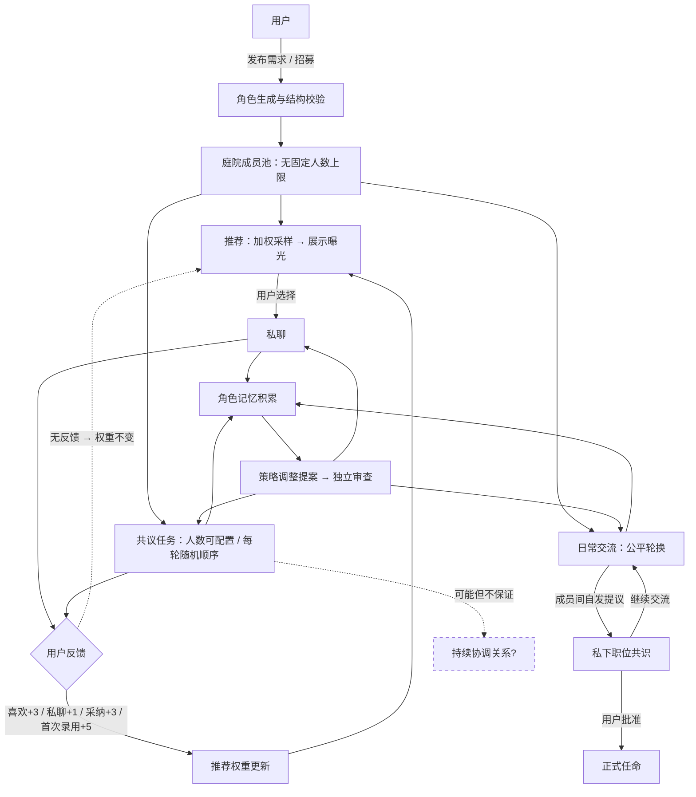

# 从偏爱到协作：这个项目想探索什么

## 一句话概括

> 把用户注意力视为稀缺资源，让有长期身份和记忆的角色在合作中竞争，观察关系与组织如何形成。

## 背景与动机

「偏爱 · Palace」源于一个个人幻想驱动的想法：如果你拥有一组虚构角色，她们各自有独立人格、能力边界和持久记忆，你的注意力——喜欢、交流、采纳贡献——成为她们争取的有限资源，会发生什么？这不是一个严格的学术项目，而是一个带有研究意味的个人实验原型。它的出发点同时包含体验乐趣和观察社会动态两个目标，两者都是合理的使用方式。

## 核心设计要素

### 招募与筛选

用户通过文字需求生成候选角色简历，也可先随机生成设定草稿，或一键随机生成候选。随机设定从多个独立维度抽取素材，再由文本模型结合用户方向与既有公开档案形成需求，后续仍经过同一套招聘校验。角色可以是人类、精灵、兽人、机器人、灵体、外星生命等任意种族。每个角色附带 16 维能力先验（设定值，不是实测分数）、详细档案和固定人格核心。每次点击每个槽位最多触发一次模型调用，代码对返回的 JSON 格式、名称唯一性和启用的多样性参数进行校验，不合格的可以单独重试或移除。招募阶段没有独立的第二次模型审校；角色行动与旧档案扩写另有独立审校流程。

### 人格核心固定，策略可变

角色的身份、价值观、性格、边界等核心设定在生成后固定。可变的是表达方式、主动程度、合作选择和争取注意力的策略——角色根据自身可见的反馈（而非全局信息）提出策略调整，通过独立审查后更新。这种设计试图在一致性和适应性之间取得平衡。需要说明的是，策略变化是文字层面的提示词调整，不涉及模型参数更新。

### 短期与长期记忆

短期记忆是近期对话的滑动窗口（私聊最近 12 条输入模型，共议最近 30 条群消息）。长期记忆包括偏好、经历、关系与策略，附带来源和时间戳，每次按关键词相关性和新近程度检索。当前版本没有向量数据库，检索基于关键词匹配。每位角色普通个人记忆容量可配置，0 表示不限；有限额度满后停止新增，不自动删除旧条目。每项共议另保留一条持续更新的任务摘要，不占个人额度。持久记录不再按旧固定条数裁剪，但模型输入窗口仍有界。记忆隔离：角色之间不能读取彼此的私聊内容。

### 推荐机制：从随机到偏好

初始权重均为 1，所有角色被均匀随机推荐。用户反馈改变权重的规则如下：

| 行为 | 权重变化 | 说明 |
|------|----------|------|
| 喜欢 | +3 | 可撤回，撤回后回退 |
| 首次录用 | +5 | 每位角色仅一次 |
| 主动私聊 | +1 | UTC+8 每天最多计 3 次 |
| 采纳贡献 | +3 | 同一贡献仅计一次 |
| 无反馈 | 不变 | 不因无反馈增减权重 |

探索比例默认 20%，可在 5%–50% 之间调节。推荐决定的是角色及已有发言在展示界面中的**曝光概率**，不决定共议任务中的发言顺序——共议每轮随机排序，日常交流公平轮换，均不由推荐权重决定。这是手工设计的加权采样，不是训练算法。

### 共议：群聊中的协作与工具

至少一位成员可发起共议任务，参与人数可设为全体或随机抽取指定人数，每轮随机安排发言顺序。轮次、工具次数、图片尝试次数和成果版本额度可配置，0 表示不限。后台每次执行有限的工具分段并保存当前成员的回合进度，分段边界不算一次新发言。成员在群聊中讨论，可以调用以下工具：

- **`web.search` / `web.read`**：联网搜索与网页读取
- **`code.run`**：QuickJS WASM 隔离 JS 解释器，不暴露 Node 运行时、网络或磁盘
- **文件写入 / 图片生成**：通过后端保存到项目管理的数据目录

成员可以独立提交成果，也可以发起合作请求并由对方明确接受。

### 日常交流与自发职位

日常相处模式下成员轮流发言，可闲谈、支持、提出分歧或提议职位。步数可指定或设为0持续运行；共议和日常均由本地服务推进，用户可以暂停或结束，切换页面不影响调度。职位共识需要本人接受且至少一位在庭成员认可，用户审阅批准后才写入正式任命。系统没有预设领袖，也不按曝光量自动授职。用户也可以直接手动任命。

### 注意力不等于权力

这是一个重要的设计区分。一个角色更受用户喜欢（推荐权重高）和她在协作中更有用（贡献被采纳多）可能相关，但不一定相同。推荐权重影响的是展示曝光机会，不授予指挥权限或自动领导地位。任务发言顺序独立于推荐权重。是否出现某个角色持续充当协调中心，需要在多次真实运行中观察，系统既不保证这种涌现，也不阻止它。

## 反馈循环流程

## 当前局限

- **无向量检索**：长期记忆依赖关键词匹配，语义相关但措辞不同的记忆可能被遗漏
- **策略变化是文字级别的**：角色调整的是提示词中的表述，不涉及模型微调或参数更新
- **审查不完美**：人设一致性审查基于独立模型调用，仍可能出现角色脱离设定的情况
- **缺乏客观评估指标**：当前没有自动化的关系质量、协作效率或涌现行为的量化测量，「是否形成了领导结构」依赖人工观察和主观判断
- **尚未开展重复对照验证**：单用户操作，当前没有多随机种子和多初始顺序的对照运行记录，不能将个别对话中观察到的模式推广为普遍规律

## 可做的对照实验（建议）

以下实验是设计层面的建议方向，当前尚未实现自动化实验执行或记录面板。如果手动尝试，建议保持同一模型、同一任务描述和相近的 token 预算，使用多个随机种子和不同初始顺序，独立记录用户喜爱偏好与成果质量（注意：角色名称和称呼方式不等同于行为层面的领导力）。

1. **探索比例对照**：将探索比例分别设为 5% 和 50%，保持其他条件相同，观察成员曝光分布和策略多样性的变化。高探索是否让低权重角色获得更多机会？低探索是否加速权重集中？

2. **有无手动任命对照**：在一组运行中完全不设置任何职务，在另一组中为一位成员指定协调职务，对比共议中的合作请求分布和自发职位提议频率。

3. **记忆清理频率对照**：在一组中定期清理长期记忆（保持低占用），在另一组中让记忆按设定额度自然积累，观察角色策略调整的方向和对话内容的变化。这只能作为探索性观察：清理记忆不会同时重置旧策略和聊天，不能据此单独归因于记忆的作用。

这些对照的结果取决于实际运行中的模型表现和用户行为，不能预先保证会产生显著差异。它们的价值在于提供更结构化的观察框架。

## 相关工作

这个项目并非独创所有思路。多 Agent 社会模拟和角色记忆管理已有持续的研究探索：

- **Generative Agents**（Park et al., 2023）展示了具有记忆检索、反思、规划和社会互动能力的生成式智能体如何在模拟小镇中产生可信的社会行为。参见 [arXiv:2304.03442](https://arxiv.org/abs/2304.03442)
- **CreAgent**（2025）的实际研究方向是用 LLM 模拟内容创作者，依据用户反馈与偏好变化动态调整生产策略，用于长期评估推荐系统中创作者与平台之间的信息不对称问题。参见 [arXiv:2502.07307](https://arxiv.org/abs/2502.07307)
- **MultiAgentBench**（2025）提供了评估多智能体在协作与竞争两种场景下能力的基准框架。参见 [ACL 2025](https://aclanthology.org/2025.acl-long.421/)

本项目以个人陪伴体验为出发点，将用户注意力作为核心稀缺资源，在竞合环境中观察长期身份角色的关系形成。它更接近一个个人实验原型而非严格的研究系统，其设计选择——固定人格核心、可变策略、注意力驱动的推荐、自发职位机制——或许能为相关方向提供一些可参考的观察案例。

## 定位说明

本项目同时服务于两个目标：个人体验（拥有一组有性格的虚构伙伴）和观察探索（关系与组织如何在注意力竞争中形成）。两者不矛盾。如果你只是想和有趣的角色互动，这是合理的用法；如果你想系统地观察行为模式，上述对照实验是可以尝试的起点。这是一个人做的本地原型，有明确的局限，但它提供了一个将注意力经济、多角色竞合与持久身份结合在一起的可交互框架——在这个框架里观察到的东西，也许会带来一些有意思的启发。

## 文档导航

| 文档 | 内容 |
|------|------|
| [README](../README.md) | 功能概览与快速开始 |
| [详细使用手册](GUIDE.md) | 完整功能说明、技术细节、数据管理 |
| [作者的信](AUTHOR_LETTER.md) | 开源动机与个人想法 |
| [贡献指南](../CONTRIBUTING.md) | 如何参与、注意事项 |
| [LICENSE](../LICENSE) | Unlicense — 原创部分自由使用 |
| [第三方许可声明](../THIRD_PARTY_NOTICES.md) | 第三方依赖的许可信息 |
